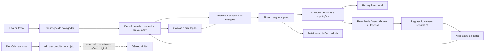

# Ativar e acompanhar os agentes do Norte

Site: <https://norte-r007.onrender.com>. No admin, abra **Agentes e métricas** (`#agentes`). As contas de teste continuam entrando em **Simulação de vigas**.

## 1. O que já funciona sem contratar outro serviço

- As abas **Canvas, Simulação, Gráficos, Resultados e Cálculos** aparecem desde o início. Também há um botão **Abrir simulação**.
- Pedidos como “quero abrir a simulação”, “quero fazer uma simulação”, “abirr simulação”, “vamos simular uma viga” e “simula a viga” funcionam sem dizer “Norte”. Abrir uma vista é uma operação local, sem chamada paga.
- Alterações como “muda a força P1 para 12 kN”, “reduz a viga em 10%” e “aumenta a viga em 1 metro” passam por interpretação, limites físicos e validação Jev. Negação, hipótese e citação continuam protegidas.
- O servidor registra resultados e consumo; uma fila persistente analisa falhas em segundo plano. Se o servidor reiniciar, trabalhos pendentes podem continuar.
- O replay de alterações físicas usa o parser e o motor de cálculo reais, sobre uma cópia da configuração. Nunca modifica a reunião em andamento.
- A API de memória consulta reuniões da própria conta. O adaptador pode ser substituído pelo gêmeo digital quando ele existir.

## 2. Configuração recomendada — 15/10/2026

Use **Jev** para as decisões estruturadas, **Gemini 3.8 Flash** para atas e **Gemini 3.5 Flash-Lite** para revisão de frases. Os dois Gemini usam uma única `GOOGLE_API_KEY`, no mesmo projeto e saldo. Não é necessário contratar OpenAI nesta configuração.

A seleção privilegia versões estáveis e um modelo leve para revisão. O Google restringe os modelos 2.5 a usuários que já os utilizavam; por isso eles deixaram de ser padrão. A qualidade real das atas deve ser conferida com reuniões representativas após validar a chave. Fontes: [modelos](https://ai.google.dev/gemini-api/docs/models), [Flash](https://ai.google.dev/gemini-api/docs/models/gemini-3.8-flash), [Flash-Lite](https://ai.google.dev/gemini-api/docs/models/gemini-3.5-flash-lite).

### Ativar no serviço existente

1. No [AI Studio](https://aistudio.google.com/apikey), obtenha uma chave de um projeto com acesso à Gemini API. Vincule a cobrança e comece com US$ 10 de crédito em [Billing](https://aistudio.google.com/billing). O mínimo de pré-pagamento publicado é US$ 5.
2. No [Render](https://dashboard.render.com), abra o serviço do Norte → **Environment**. Atualize `GOOGLE_API_KEY` e preserve `TYPESAFE_API_KEY`, `ADMIN_PASSWORD` e `DATABASE_URL`. Se houver `GEMINI_API_KEY` antiga, remova-a ou atualize-a também: esse alias tem prioridade sobre `GOOGLE_API_KEY` na mesma origem.
3. Importe **[render.env](render.env)** com **Add from .env**. O arquivo contém somente configurações públicas, sem chaves ou senha. Salve as alterações.
4. Publique o código atualizado e faça **Manual Deploy → Deploy latest commit**. Um serviço existente não importa automaticamente o YAML a cada deploy.
5. Rode o diagnóstico abaixo no ambiente que quer verificar e entre como admin em **Agentes e métricas**.

```bash
# Apenas autenticação; não gera conteúdo nem testa o saldo para geração:
python3 scripts/check_apis.py
# Testes sintéticos pequenos com os adaptadores reais; consomem créditos:
python3 scripts/check_apis.py --live
```

O diagnóstico não mostra chaves, não envia reuniões e não escreve no banco de produção. Sucesso em listar modelos não comprova permissão de geração. O teste com `--live` verifica uma classificação Jev, uma ata com evidência e uma intenção, somente quando a consulta autenticada do fornecedor passa. Isso não substitui teste de carga ou avaliação de qualidade de reuniões reais.

No diagnóstico local de 15/10/2026, a listagem TypeSafe autenticou e a listagem Google retornou **HTTP 401**. É necessário corrigir a autenticação Google; não tratar o erro como prova de falta de créditos. Isso não informa o estado de outra chave configurada no Render.

### Custos e limites

| Uso | Modelo | Entrada / saída, US$ por milhão de tokens |
| --- | --- | --- |
| Classificação | `jev-latest` | 0.042 / 0 |
| Atas | `gemini-3.8-flash` | 0.75 / 3.75 até 31/12/2026 |
| Agentes | `gemini-3.5-flash-lite` | 0.30 / 2.50 |

Em **01/01/2027**, atualize `MINUTES_INPUT_USD_PER_MILLION=1.50` e `MINUTES_OUTPUT_USD_PER_MILLION=7.50`, conforme o fim da promoção publicado. As tarifas configuradas servem para estimar consumo; não compram saldo. [Preços Gemini](https://ai.google.dev/gemini-api/docs/pricing), [TypeSafe](https://docs.typesafe.ai/models), [cobrança Google](https://ai.google.dev/gemini-api/docs/billing).

- `AI_DAILY_BUDGET_USD=1.00` e `AI_DAILY_CALL_LIMIT=50`: revisão e resolução de intenções dos agentes. Não incluem Jev nem atas.
- `MINUTES_DAILY_CALL_LIMIT=50`: até 50 tentativas de organização de atas por dia UTC, compartilhadas entre contas e persistentes após reiniciar. Erros também gastam uma tentativa. A repetição interna de um erro 503, no máximo uma por tentativa, pode fazer uma chamada adicional. Zero desativa novas organizações.
- Uma organização bloqueada pelo limite não chama o provedor nem aparece como chamada paga. A ata atual e a exportação local continuam disponíveis.
- O limite de atas é por quantidade, **não por dólares**. Jev continua sendo cobrado por uso. Acompanhe os painéis dos provedores; a fatura é a referência.
- `MINUTES_INPUT_USD_PER_MILLION` e `MINUTES_OUTPUT_USD_PER_MILLION`: tarifas exclusivas das atas; incluem a contabilização de raciocínio quando o provedor informa o uso. Alterar modelo exige conferir as tarifas. Uso ausente permanece desconhecido.

### Alternativa OpenAI já existente

O adaptador OpenAI foi preservado para instalações existentes, mas não é usado nem exige saldo na configuração acima. O padrão legado `gpt-4.1-mini` será desligado em 14/01/2027: valide um substituto e suas tarifas antes de adotar essa alternativa. Selecionar OpenAI para os agentes não substitui o Gemini das atas. [Aviso oficial](https://developers.openai.com/api/docs/deprecations).

## 3. Preciso pagar mais no Render?

Para testes ocasionais, o plano gratuito executa a aplicação e a fila enquanto o serviço está acordado. **Para os agentes continuarem trabalhando sem depender de alguém abrir o site, use um serviço pago sempre ativo.** A fila fica no Postgres; não exige Redis nem uma segunda máquina nesta implantação inicial.

No Render, abra o serviço → **Compute** → **Edit** → escolha **0.5c-512mb**, anteriormente chamado **Starter**. Faça o mesmo com o banco, escolhendo um Postgres pago adequado, inicialmente **0.1c-256mb**, anteriormente **Basic-256mb**. Confira o preço exibido antes de confirmar. Como referência, o Render publicou cerca de **US$ 13/mês** para essa combinação, antes de crescimento de armazenamento/tráfego. [Planos de computação](https://render.com/docs/compute-plans), [referência de custos](https://render.com/articles/how-much-does-cloud-application-hosting-cost-for-small-businesses).

O serviço gratuito dorme após 15 minutos sem tráfego, e o Postgres gratuito expira após 30 dias. Não armazene a única cópia das reuniões em SQLite no Render: o filesystem é efêmero. Mantenha `DATABASE_URL` ligada ao Postgres. [Limites gratuitos](https://render.com/docs/free).

O `render.yaml` agora declara servidor `0.5c-512mb` e banco `0.1c-256mb`, ambos pagos. Alterar o arquivo local não compra recursos; aplicar/sincronizar o Blueprint no Render contrata os planos declarados. Em uma instalação existente, altere o Compute do servidor e do banco separadamente. Ele inclui as novas variáveis para instalações/sincronizações por Blueprint. Em um serviço já existente, confira **Environment**; publicar o código não garante importar novas variáveis do YAML.

O replay físico requer Node.js, disponível nos runtimes nativos do Render. Se faltar em outro ambiente, o histórico informa a indisponibilidade; o processamento da reunião continua. [Ferramentas dos runtimes](https://render.com/docs/native-runtimes).

## 4. Como as três camadas trabalham



O Jev classifica texto; a transcrição do áudio continua sendo feita pelo navegador. Os agentes não são três serviços pagos independentes: são tarefas com funções diferentes, coordenadas pelo mesmo backend.

**Auditoria:** procura pedidos não reconhecidos, repetições, recuperação após outro pedido/click e avaliações negativas. **Validação:** reproduz operações localmente e testa candidatos de navegação contra regressões e casos separados. **Métricas:** consolida execução, avaliações, latência e uso dos provedores. A revisão semântica só envia uma frase candidata e sua contagem de recuperações; nunca envia o estado físico, memória completa, conta ou reunião inteira.

## 5. O que aprende sozinho, e o limite atual

Se uma frase de abertura falhar repetidamente e depois houver uma abertura bem-sucedida, o auditor registra a recuperação. Evidências em **duas sessões independentes**, confirmação semântica (ou rótulos humanos suficientes) e testes aprovados permitem ativar um **alias exato de abertura para aquela conta**. O admin pode desativá-lo no histórico. `AI_AUTO_PUBLISH=false` mantém as propostas sem ativação automática.

Isso aprende regras de interpretação da aplicação; **não retreina os pesos do Jev/Gemini/OpenAI**. Uma conta não publica regras nas outras. Falhas de parâmetros físicos são reproduzidas e diagnosticadas, mas não geram alterações de código, fórmulas ou prompts em produção. O sistema não inventa números ausentes. Correções que exigirem mudar o software continuam exigindo desenvolvimento. Essa fronteira evita que uma avaliação errada degrade os cálculos.

O ganho prático imediato está na linguagem natural ampliada, funções visíveis, respostas locais rápidas, recuperação de frases e reprodução automática de falhas. Não existe garantia de compreender todas as falas possíveis nem de eliminar toda intervenção futura.

## 6. Ler o dashboard sem confundir as métricas

| Indicador | O que mede |
| --- | --- |
| Acerto validado | Avaliações explícitas de usuários. Sem avaliações, mostra “—”. |
| Execução operacional | Pedidos/eventos processados com sucesso técnico. Não comprova que a intenção foi entendida. |
| Latência p50 / p95 | Distribuição do tempo observado nos eventos retidos; não é só velocidade do modelo. |
| Propostas publicadas | Proporção de propostas que passaram pelos critérios de ativação. Não é melhoria percentual de acurácia. |
| Replay | Resultado de casos de teste do adaptador indicado. Não representa acerto geral em conversas reais. |
| Tokens | Uso informado pelos provedores. Ausência de informação não é estimada como token zero de uma chamada conhecida. |
| Custo estimado | Tokens medidos × tarifas configuradas. Chamadas com preço desconhecido ficam destacadas e fora da soma. |

Os custos exibidos não incluem Render, impostos, câmbio ou serviços externos de transcrição. O orçamento diário limita **revisão semântica dos agentes/resolver**, compartilhado pelas contas; não limita o Jev das reuniões nem a geração de atas. O dia de orçamento usa UTC. Uma tentativa sem resposta conserva a reserva de custo para não tratar uma chamada possivelmente cobrada como gratuita.

Em **Arquitetura atual**, clique nos blocos para ver as perguntas e opções do Jev carregadas dos mesmos arquivos que a aplicação usa. O flow anterior permanece disponível. Em **Testar interpretações**, execute a bateria local ou forneça casos com resultado esperado. **Exportar PDF** abre a impressão: escolha **Salvar como PDF**.

## 7. Conferência depois do deploy

1. Abra o site em janela anônima e crie uma conta comum.
2. Crie uma reunião: confira as cinco abas e o botão **Abrir simulação**.
3. Abra a simulação por click. Explore gráficos, resultados e cálculos sem iniciar o microfone.
4. Inicie a reunião e diga ou escreva “quero fazer uma simulação”. Experimente “muda a força P1 para 12 kN” e “reduz a viga em 10%”.
5. Confira a mudança na vista/valor e use **Entendeu / Não era isso** quando quiser fornecer uma avaliação.
6. Entre no admin → **Agentes e métricas** → **Atualizar**. Confira eventos, consumo, jobs e diagnósticos. O painel começa sem acurácia validada: isso é esperado.
7. Clique em **Testar interpretações** e rode o replay. Confira seu escopo antes de usar o resultado em uma apresentação.

Se o deploy não atualizar: serviço Render → **Manual Deploy** → **Deploy latest commit**. O branch é `main` do repositório <https://github.com/Raiagues/piloto>.

## 8. API preparada para a memória do projeto

`POST /api/ai/memory/query` recebe `{"query":"resultado da viga","session_id":"opcional"}` com a sessão autenticada. A resposta traz trechos, IDs de evento/reunião, origem e limites de consulta. A busca atual é lexical, restrita às 30 reuniões recentes dentro do limite de tamanho, sem inventar um gêmeo digital conectado. `ProjectMemory` em `ai_runtime.py` é o ponto de substituição por uma fonte futura.

Histórico/telemetria usam SQLite local ou o mesmo Postgres das contas. A retenção padrão é 90 dias para eventos, uso e avaliações. Regras publicadas continuam versionadas. Nenhuma chave é enviada ao navegador.
