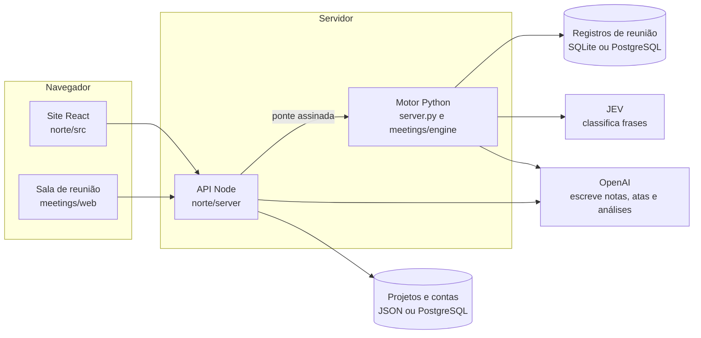
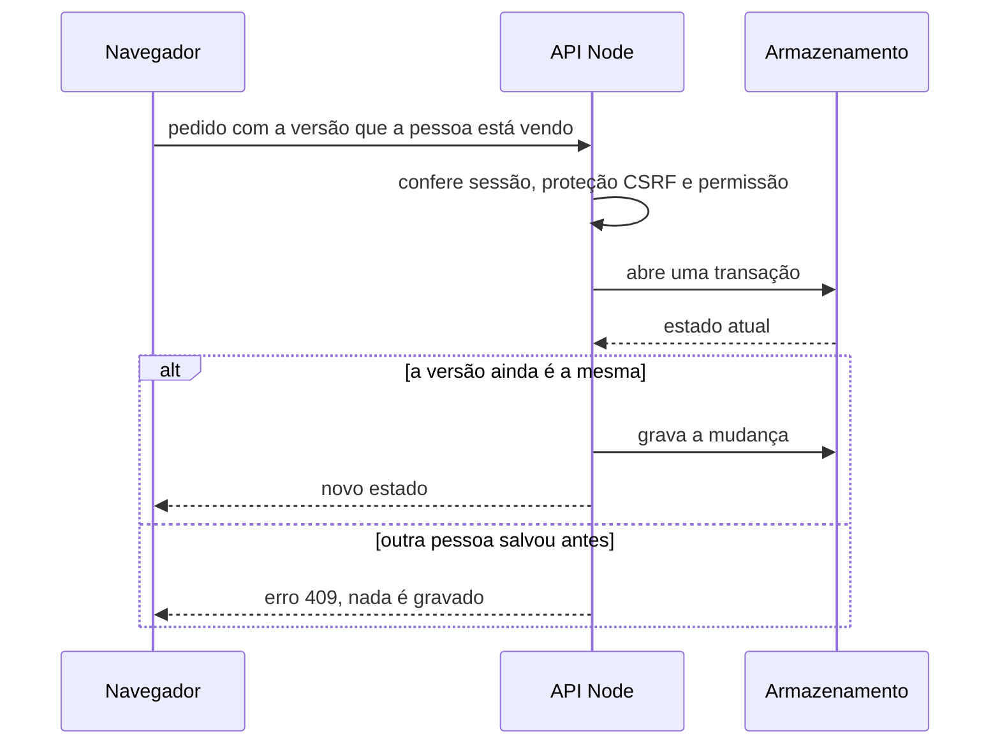
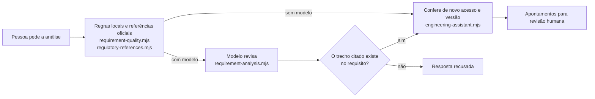
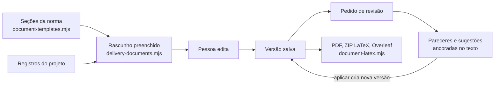
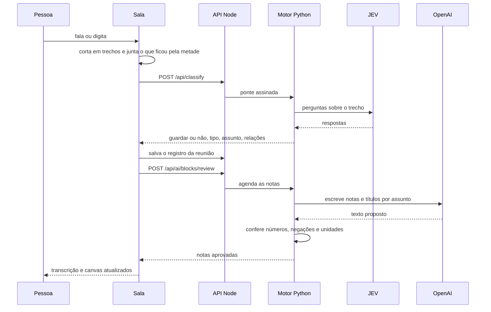
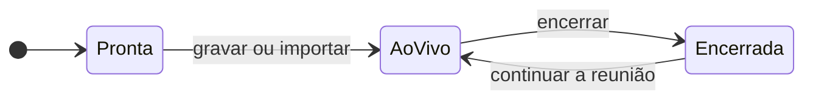
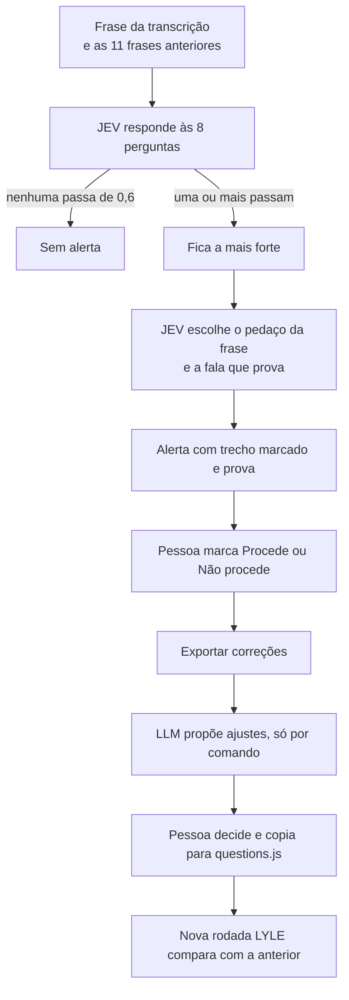
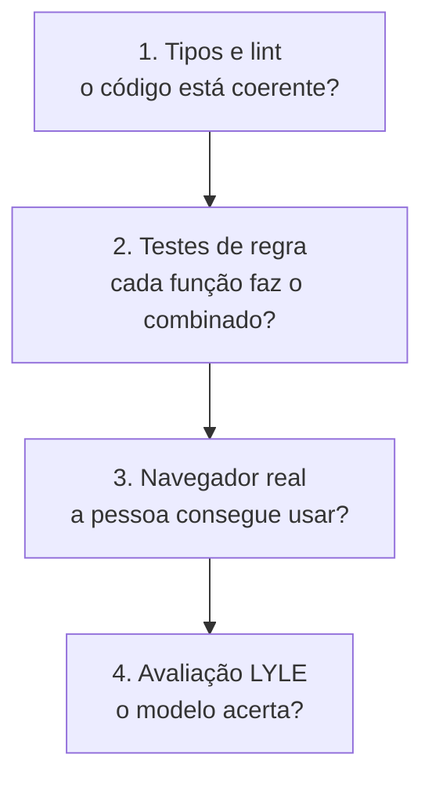

# Norte

O Norte é um site para equipes de engenharia cuidarem de requisitos, cronograma, documentos de revisão e reuniões no mesmo lugar. A equipe consegue ver de onde veio cada requisito, o que mudou, quem revisou e em que situação cada documento está.

A instalação começa vazia. Contas, equipes e projetos só aparecem depois que alguém os cria, e o Norte não inventa pessoas, resultados de ensaio nem aprovações. A inteligência artificial sugere, e uma pessoa sempre revisa.

Este README explica o projeto do começo ao fim, para quem nunca abriu o código.

1. [Como rodar](#1-como-rodar)
2. [A arquitetura em uma página](#2-a-arquitetura-em-uma-página)
3. [Como cada função funciona](#3-como-cada-função-funciona)
4. [Inteligência artificial](#4-inteligência-artificial)
5. [Onde mudar cada coisa](#5-onde-mudar-cada-coisa)
6. [Testes](#6-testes)
7. [Dados e privacidade](#7-dados-e-privacidade)
8. [Outros documentos](#8-outros-documentos)

## 1. Como rodar

Com Docker é o caminho mais curto. A imagem já traz Node, Python e Poppler, e os dados ficam no volume `norte-data`.

```bash
docker compose up --build -d
```

Depois abra `http://localhost:8000`.

Sem Docker, o Norte precisa de Linux, Python 3, Node 24.20 ou mais novo e Poppler (`poppler-utils`).

```bash
./setup                # instala as dependências e compila a interface
./start --no-browser   # sobe os serviços em http://127.0.0.1:8000
./stop                 # encerra os serviços
```

Sem `--no-browser`, o `./start` também abre o navegador. A variável `PORT` no `.env` muda a porta, e `./prepare-local` baixa uma cópia do Node quando a do sistema é antiga. Dados e logs locais ficam em `.runtime/`, fora do Git.

Para entrar, crie uma conta com nome, login e senha. O e-mail é opcional, porque convites por nickname funcionam sem servidor de e-mail. Em produção, a primeira administração exige o código privado `NORTE_BOOTSTRAP_TOKEN`, e as estatísticas globais pedem também um código de autenticação.

As chaves de IA ficam no arquivo `.env`, que não vai para o Git. Sem chave, a função avisa que não está configurada e não mostra nenhum resultado falso. A lista completa está em `.env.example`, e estas são as principais.

| Variável | Para que serve | Valor padrão |
| --- | --- | --- |
| `TYPESAFE_API_KEY` | Classificação de frases pelo JEV | vazio |
| `OPENAI_API_KEY` | Notas, atas e análises | vazio |
| `NORTE_LLM_PROVIDER` | Provedor dos modelos de linguagem | `openai` |
| `NORTE_MEETING_EDITOR_MODEL` | Notas e títulos durante a reunião | `gpt-6-luna` |
| `NORTE_MINUTES_MODEL` | Ata completa | `gpt-6.1-sol` |
| `NORTE_ENGINEERING_MODEL` | Requisitos, referências e rascunhos | `gpt-6.1-sol` |
| `NORTE_DELIVERY_READ_ONLY` | Versão de teste só de leitura | `0` |

Para análises muito difíceis, troque `NORTE_ENGINEERING_MODEL` por `gpt-6-astra`. As tarifas de cada modelo também ficam no `.env`, porque o orçamento diário depende delas. Sem tarifa, as notas da reunião não rodam.

No Render, essas variáveis são preenchidas na tela do serviço. Mudar o `render.yaml` não muda um serviço que já existe.

## 2. A arquitetura em uma página

O Norte tem duas partes no navegador e duas no servidor. O site é feito em React. A sala de reunião é uma página separada, em JavaScript simples, que abre dentro do site. No servidor, a API em Node guarda contas, projetos e permissões, e o motor em Python cuida do que é pesado nas reuniões.



A regra mais importante é que o Node decide quem pode fazer o quê. O navegador nunca fala direto com o Python, e as chaves nunca chegam ao navegador. O Python só aceita pedidos que vêm pela ponte assinada, em uma porta interna. O script `scripts/service.py` sobe os dois serviços, e só o Node fica aberto para fora.

Toda escrita segue o mesmo caminho. É isso que mantém os dados certos quando duas pessoas mexem no mesmo registro.



| Pasta | O que tem |
| --- | --- |
| `norte/src/pages` | Uma página por rota, carregada só quando é aberta |
| `norte/src/components` | Partes da interface, agrupadas por função |
| `norte/src/lib` | Sessão, navegação e chamadas à API |
| `norte/src/styles` | Cores em `tokens.css` e estilos de cada função |
| `norte/server` | API, permissões, armazenamento, documentos e análises |
| `norte/shared` | Regras usadas pelo site e pela API, como os modelos de documento |
| `meetings/web` | A sala de reunião |
| `meetings/engine` | Notas, atas e correções, em Python |
| `prompts` | Todos os textos enviados aos modelos |
| `scripts` | Instalação, serviços e diagnóstico |
| `tests`, `norte/tests` | Testes da sala, do motor e do site |
| `docs` | Documentos de cada assunto |
| `novo_teste` | Documentos LYLE e resultados, só na sua máquina, fora do Git |

## 3. Como cada função funciona

Cada parte abaixo explica a função em poucas frases e termina com os arquivos que a implementam.

### 3.1 Contas, equipes e permissões

Uma equipe representa a empresa ou o grupo, e cada projeto pertence a uma equipe. A pessoa entra por convite. Participar da equipe não dá acesso a tudo, porque leitura e edição dependem do projeto e do setor. Ser administrador da plataforma também não abre projetos, conversas nem reuniões privadas. Os detalhes estão em [equipes e permissões](docs/teams.md).

| Arquivo | Papel |
| --- | --- |
| `norte/server/app.mjs` | Monta a API, cuida de sessão, cadastro, equipes e projetos |
| `norte/server/team-invitations.mjs` | Convites por nickname e por e-mail |
| `norte/server/project-organization.mjs` | Setores, cargos e quem pode o quê em cada projeto |
| `norte/server/platform-security.mjs` | Autenticação em dois fatores da administração |
| `norte/server/data-store.mjs`, `postgres-store.mjs` | Armazenamento em arquivo JSON ou PostgreSQL |
| `norte/src/lib/auth.tsx` | Sessão no navegador |
| `norte/src/pages/AuthPage.tsx`, `TeamsHubPage.tsx`, `PeoplePage.tsx` | Entrada, equipes e contatos |

### 3.2 Navegação, busca e visão geral

A barra lateral mostra Início, Equipes e o projeto ativo. Requisitos, Cronograma e Reuniões têm uma seta para recolher a lista, e o item aberto fica em negrito, na cor de destaque. A busca (`Ctrl K`) roda no navegador, sem modelo de linguagem, e entende pedidos como "revisões atrasadas". A visão geral do projeto mostra só equipe, setores, pessoas, última atualização, próximo marco, próximos marcos e reuniões.

| Arquivo | Papel |
| --- | --- |
| `norte/src/components/MissionSidebar.tsx`, `norte/src/lib/sidebarTree.ts` | Barra lateral e sua árvore |
| `norte/src/components/AppHeader.tsx`, `norte/src/lib/workspaceRoutes.ts` | Cabeçalho, botão Voltar e rotas |
| `norte/src/components/WorkspaceSearch.tsx`, `norte/src/lib/workspaceSearch.ts`, `searchIndex.ts` | Busca |
| `norte/src/lib/workspaceIndex.ts` | Dados do projeto ativo, compartilhados entre barra, busca e Início |
| `norte/src/pages/HomePage.tsx`, `norte/src/lib/homeOverview.ts` | Início |
| `norte/src/pages/ProjectOverviewPage.tsx` | Visão geral do projeto |

### 3.3 Requisitos e análises

O requisito aparece em tabela ou em árvore por subsistema. Abrir a página nunca chama um modelo. A análise só roda quando alguém clica, e o progresso mostra as etapas e as fontes consultadas. Cada apontamento marca o trecho exato do requisito e cita a referência oficial. Requisito, método, critério, fonte e resultado são conceitos separados, e uma mudança relevante invalida as aprovações antigas.



| Arquivo | Papel |
| --- | --- |
| `norte/server/project-delivery.mjs` | Guarda requisitos, cronograma e documentos, e valida cada mudança |
| `norte/server/engineering-assistant.mjs` | Execução das análises, etapas e conferência antes de concluir |
| `norte/server/requirement-analysis.mjs` | Pedido ao modelo para revisar um requisito |
| `norte/shared/requirement-quality.mjs` | Regras locais de redação e conferência do trecho citado |
| `norte/shared/regulatory-references.mjs` | Catálogo de referências oficiais |
| `norte/src/pages/RequirementsPage.tsx`, `norte/src/components/delivery/RequirementsExplorer.tsx` | Tabela, árvore e filtros |
| `norte/src/components/delivery/RequirementHighlights.tsx` | Pinta os trechos apontados |

### 3.4 Cronograma

O cronograma começa vazio. A equipe escolhe um modelo de referência, edita e aprova. O Gantt mostra uma faixa por fase, as revisões como losangos e as atividades empilhadas sem sobreposição. A aba Revisões agrupa as revisões por fase, e cada uma abre para baixo com o responsável, o pacote de documentos, os critérios e a aprovação.

| Arquivo | Papel |
| --- | --- |
| `norte/src/pages/SchedulePage.tsx` | Página e abas |
| `norte/src/components/delivery/LifecycleBoard.tsx`, `norte/src/lib/ganttLayout.ts` | Desenho do Gantt |
| `norte/src/components/delivery/ReviewTree.tsx`, `ReviewDocuments.tsx` | Revisões e seus pacotes |
| `norte/src/lib/schedulePlanning.ts`, `scheduleEditing.ts` | Datas, dependências e desfazer |
| `norte/shared/delivery-lifecycle.mjs`, `delivery-standards.mjs` | Fases e revisões de cada norma |

### 3.5 Documentos de revisão

Cada revisão tem um pacote de documentos que segue a norma escolhida. O perfil ECSS usa a ECSS-E-ST-10C Rev.1, e o perfil NASA usa o NPR 7123.1D. Clicar em um documento planejado abre um rascunho já preenchido com o que existe no projeto. O que falta fica marcado como PENDENTE, e o Norte não inventa valores.



Quem edita pode aplicar ou descartar cada sugestão de um revisor. Aplicar cria uma nova versão e zera os pareceres. O botão Ver exemplo mostra como seria uma revisão, com perfis fictícios rotulados, gerados só no navegador. Esse exemplo nunca é salvo e nunca conta como aprovação.

O ZIP LaTeX abre no Overleaf e compila com pdfLaTeX. O botão Enviar cópia ao Overleaf abre uma cópia em overleaf.com, só quando alguém clica. Essa cópia não sincroniza de volta, então revisão e aprovação continuam no Norte. A instalação local do Overleaf está explicada em [Overleaf](docs/overleaf.md).

Com `NORTE_DELIVERY_READ_ONLY=1`, requisitos, cronograma e documentos mostram o aviso de versão de teste. Eles continuam abrindo e exportando, mas o servidor recusa as escritas com erro 423.

| Arquivo | Papel |
| --- | --- |
| `norte/shared/document-templates.mjs` | Catálogo com seções, orientação e maturidade por revisão |
| `norte/server/delivery-documents.mjs` | Monta o rascunho a partir dos registros |
| `norte/server/document-latex.mjs` | Converte para LaTeX, sem deixar o texto virar comando |
| `norte/server/artifact-pdf.mjs` | Gera o PDF |
| `norte/src/components/delivery/DocumentWorkspace.tsx` | Abre o documento salvo ou o modelo |
| `norte/src/components/delivery/DocumentTemplatePage.tsx` | Modelo ainda não criado |
| `norte/src/components/delivery/DocumentDraftPanel.tsx` | Editor, prévia e exportações |
| `norte/src/components/delivery/DocumentReviewPanel.tsx` | Pedido de revisão, pareceres e sugestões |
| `norte/src/lib/documentReviewExample.ts` | Exemplo de revisão com perfis fictícios |
| `norte/scripts/check-overleaf-export.mjs` | Compila as exportações de verdade |

### 3.6 Reuniões ao vivo

A sala mostra a transcrição à esquerda e o canvas à direita, igual ao exemplo da página inicial. A fala entra pelo microfone, por texto digitado ou por um arquivo de transcrição. O modelo trabalha só com a transcrição, e ninguém edita o canvas nem a ata enquanto a reunião acontece.

Cada pedaço de fala passa por estas etapas.



O corte funciona assim. Uma frase com pontuação vira um trecho se tiver até 40 palavras, e uma frase maior é dividida em orações. A fala do microfone não tem pontuação, então é cortada entre 12 e 18 palavras. Se o orador parou no meio da ideia, a sala espera o pedaço seguinte, com limite de 32 palavras e 6 segundos.

O JEV responde às perguntas de `prompts/jev/questions.js`. Primeiro ele diz se o trecho guarda informação do projeto e qual é o tipo, como observação, hipótese, decisão ou requisito. Depois escolhe o assunto entre os recentes, ou abre um novo. Por fim aponta as relações entre eventos, como um resultado que responde a um teste. Comandos para a sala só são verificados quando a fala menciona o Norte ou responde a um pedido pendente.

Em segundo plano, o modelo editorial escreve as notas. A nota só é publicada se mantiver os números, as negações e as unidades da fala. Um segundo pedido confere a fidelidade. Quando a nota falha, a fala original continua aparecendo. Mais detalhes estão em [processamento das reuniões](docs/meeting-memory.md).

| Arquivo | Papel |
| --- | --- |
| `meetings/web/meeting-room.js` | A página da sala e seus controles |
| `meetings/web/meeting-speech.js`, `speech-windows.js`, `transcription.js` | Corte da fala, janelas do microfone e registro do que foi reconhecido |
| `meetings/web/meeting-session.js` | Fila de trechos e ordem das chamadas |
| `meetings/web/memory-flow.js` | Monta o pedido de cada trecho e refaz os eventos |
| `meetings/web/thread-worker.js` | Escolhe o assunto de cada evento |
| `meetings/web/typed-relations.js` | Relações entre eventos |
| `meetings/web/classifier-transport.js` | Envia os pedidos de classificação |
| `meetings/web/jev-answers.js` | Valida pedidos e respostas do JEV |
| `meetings/web/meeting-commands.js` | Comandos falados, como renomear um assunto |
| `meetings/web/meeting-hierarchy.js`, `meeting-canvas.js` | Organiza os eventos e desenha o canvas |
| `meetings/web/meeting-blocks.js` | Coloca as notas e títulos sobre as falas |
| `meetings/web/meeting-state.js`, `meeting-evidence.js` | Estado atual de cada evento e o que a tela mostra, sem tocar no registro original |
| `meetings/web/meeting-review.js` | Orienta a revisão de uma fala que ficou de fora |
| `meetings/web/meeting-i18n.js` | Idioma da interface da sala |
| `meetings/web/meeting-live-minutes.js` | Ata só de leitura durante a reunião |
| `meetings/web/norte-meeting-bridge.js` | Liga a sala à conta do Norte |
| `meetings/web/remote-storage.js`, `memory-storage.js` | Salva o registro na conta ou no navegador |
| `norte/server/meeting-gateway.mjs` | Autoriza cada pedido da sala e o encaminha ao Python |
| `norte/server/meeting-service.mjs` | Reuniões, convites e notas pessoais |
| `norte/server/meeting-audio.mjs` | Conexão de áudio entre participantes |
| `server.py` | Entrada do motor Python e chamada ao JEV |
| `meetings/engine/meeting_bridge.py` | Confere a assinatura da ponte |
| `meetings/engine/block_agents.py`, `ai_runtime.py` | Notas e títulos, fila de trabalho e orçamento |

### 3.7 Antes, durante e depois da reunião

O que cada pessoa pode fazer depende do momento.



| O que | Ao vivo | Encerrada |
| --- | --- | --- |
| Ler transcrição, canvas e ata | Sim | Sim |
| Escrever notas pessoais | Sim | Sim |
| Corrigir o canvas | Não | Sim |
| Editar e organizar a ata | Não | Sim |
| Analisar alertas | Não | Sim |

As notas pessoais servem para lembrar de corrigir algo depois. Cada pessoa vê só as próprias notas. Elas ficam ao lado da reunião, e por isso nunca entram no registro, na ata nem em um pedido a modelo. A trava de edição fica na interface da sala, porque o registro em andamento é escrito pelo navegador do anfitrião.

| Arquivo | Papel |
| --- | --- |
| `meetings/web/meeting-notes.js` | Notas pessoais na sala |
| `meetings/web/meeting-canvas.js` | Bloqueia a edição enquanto a reunião roda |
| `norte/server/meeting-service.mjs` | Rotas `/api/meetings/:id/notes`, separadas por pessoa |
| `norte/src/components/LandingMeeting.tsx`, `landingMeetingScript.ts` | Exemplo ilustrativo da página inicial |

### 3.8 Ata

Depois de encerrar, a pessoa pede a organização da ata. O modelo reescreve a partir dos eventos, assuntos e notas já validados. Antes de aceitar a resposta, o código confere se nenhum ID mudou, se nenhuma fala sumiu e se os números e correções humanas continuam iguais. Uma correção humana sempre vence a nota automática. Se a validação falha, o texto original fica no lugar, com um aviso para revisão.

| Arquivo | Papel |
| --- | --- |
| `meetings/engine/minutes.py` | Pede a ata ao modelo e valida a resposta |
| `meetings/web/minutes-editor.js` | Editor da ata depois da reunião |
| `meetings/web/meeting-minutes.js`, `meeting-document.js` | Ata local, comentários e PDF |
| `meetings/web/meeting-amendments.js` | Correções humanas sobre o que foi extraído |
| `meetings/engine/meeting_learning.py` | Exemplos de correção, válidos só naquela reunião |

### 3.9 Alertas marcados no texto

Depois da reunião, o botão Analisar falas procura problemas na transcrição, como alguém afastar uma regra de controle de exportação sem análise concluída. O alerta pinta exatamente o trecho do problema e mostra a fala que serve de prova, na mesma estrutura dos apontamentos de requisitos. O JEV faz essa análise, então nenhum modelo de linguagem é chamado.



As oito perguntas estão documentadas uma a uma em [prompts/README.md](prompts/README.md), com o que cada uma procura e o que não conta.

| Pergunta | O que procura |
| --- | --- |
| `regulatory_dismissal` | Afastar um regime de controle sem classificação concluída |
| `meaning_conflict` | O mesmo valor com duas leituras ou dois números |
| `contradicts_record` | Registrar como fato o oposto do que já foi dito |
| `premature_commitment` | Fechar agora e deixar a dependência para depois |
| `unsupported_conclusion` | Ir de uma evidência parcial a uma conclusão ampla |
| `controlled_transfer` | Plano de enviar conteúdo técnico a terceiro estrangeiro sem verificar controles |
| `schedule_conflict` | Data confirmada que não cabe nos prazos já ditos |
| `status_without_evidence` | Registro que mostra situação além da evidência |

| Arquivo | Papel |
| --- | --- |
| `meetings/web/meeting-highlights.js` | Divide em frases, faz as perguntas e monta os alertas |
| `meetings/web/meeting-room.js` | Painel de alertas e marcação no texto |
| `prompts/jev/questions.js` | Perguntas `highlights`, `highlightFragment` e `highlightEvidence` |
| `scripts/refine_highlight_questions.py` | Pede ajustes à LLM, com recusa de exemplos copiados de uma reunião |

### 3.10 Mensagens e administração

Mensagens aceitam texto e imagens, na ordem em que foram compostos. A administração mostra contas, métricas opcionais e o diagnóstico das reuniões às quais a pessoa tem acesso. O diagnóstico exibe as entradas, perguntas e respostas registradas, sem revelar raciocínio interno de modelo.

| Arquivo | Papel |
| --- | --- |
| `norte/server/conversation-service.mjs`, `norte/src/pages/MessagesPage.tsx` | Mensagens |
| `norte/server/meeting-observability.mjs`, `norte/src/pages/MeetingObservabilityPage.tsx` | Diagnóstico das reuniões |
| `norte/server/platform-telemetry.mjs`, `norte/src/pages/PlatformAdminPage.tsx` | Métricas opcionais e administração |

## 4. Inteligência artificial

O Norte usa dois tipos de modelo, com papéis diferentes. O JEV lê uma frase e responde a perguntas fechadas, como sim ou não, ou uma opção de uma lista. Ele nunca escreve texto. O modelo de linguagem, chamado de LLM, escreve notas, atas e análises. Essa divisão deixa a classificação barata e rápida.

| Tarefa | Quem faz | Modelo padrão | Prompt | Código |
| --- | --- | --- | --- | --- |
| Corte da fala, tipo, assunto, relações | JEV | `jev-latest` | `prompts/jev/questions.js` | `meetings/web/meeting-session.js`, `memory-flow.js`, `thread-worker.js`, `typed-relations.js` |
| Alertas no texto | JEV | `jev-latest` | `prompts/jev/questions.js` | `meetings/web/meeting-highlights.js` |
| Notas e títulos | LLM | `gpt-6-luna` | `prompts/llm/meeting-*.md` | `meetings/engine/block_agents.py` |
| Ata | LLM | `gpt-6.1-sol` | `prompts/llm/minutes.md` | `meetings/engine/minutes.py` |
| Revisão de requisito | LLM | `gpt-6.1-sol` | `prompts/llm/requirement-review.md` | `norte/server/requirement-analysis.mjs` |
| Referências, verificação, rascunho | LLM | `gpt-6.1-sol` | `prompts/llm/engineering-*.md` | `norte/server/engineering-assistant.mjs` |
| Ajuste das perguntas de alerta | LLM | `gpt-6.1-sol` | `prompts/llm/highlight-questions.md` | `scripts/refine_highlight_questions.py` |

O formato de cada provedor fica isolado em `meetings/engine/llm.py` e `norte/server/llm-transport.mjs`. As verificações ficam nos fluxos, então valem para qualquer provedor. O adaptador Google continua disponível com `NORTE_LLM_PROVIDER=gemini`, e nenhum fluxo depende dele.

O orçamento diário fica em `AI_DAILY_BUDGET_USD` e `AI_DAILY_CALL_LIMIT`. O custo de cada chamada usa as tarifas do `.env` e os tokens que o provedor informou. O comando `python3 scripts/check_apis.py` testa as chaves e mostra o provedor em uso, sem imprimir segredos.

## 5. Onde mudar cada coisa

| Quero mudar | Arquivo |
| --- | --- |
| Um prompt da LLM | `prompts/llm/`, um arquivo por tarefa |
| Uma pergunta do JEV | `prompts/jev/questions.js` |
| O modelo ou a tarifa | `.env`, com a lista em `.env.example` |
| Uma cor | `norte/src/styles/tokens.css`, que vale também para a sala |
| Um modelo de documento | `norte/shared/document-templates.mjs` |
| As fases de uma norma | `norte/shared/delivery-lifecycle.mjs`, `delivery-standards.mjs` |
| As referências oficiais | `norte/shared/regulatory-references.mjs` |
| O texto da política de privacidade | `norte/server/privacy.mjs` |
| O exemplo da página inicial | `norte/src/components/landingMeetingScript.ts` |

Depois de mudar um prompt, reinicie o serviço. Depois de mudar uma pergunta do JEV, rode os testes e uma rodada LYLE para ver se melhorou. O passo a passo está em [prompts/README.md](prompts/README.md).

## 6. Testes

Os testes têm quatro camadas. As três primeiras são grátis e rodam sem nenhuma chave, com provedores simulados. Por isso elas mostram que o sistema funciona, mas não dizem se o modelo acerta. A quarta usa o JEV real nos documentos LYLE e é a única que mede qualidade.



### 6.1 O que cada suíte protege

| Comando | O que testa | Última execução, em 3/11/2026 |
| --- | --- | --- |
| `npm --prefix norte run typecheck` e `lint` | Tipos e problemas no código | Sem erros |
| `npm --prefix norte exec -- vitest run` | Regras do site, como busca, Gantt e exemplo de revisão | 84 passaram |
| `npm --prefix norte run test:api` | API, permissões, conflito de versão, migrações, documentos e LaTeX | 234 passaram, 12 pulados por exigirem PostgreSQL real |
| `node --test tests/*.test.cjs` | Sala, corte da fala, assuntos, relações, ata e alertas | 359 passaram |
| `python3 -m unittest discover -s tests -p 'test_*.py'` | Motor Python, ponte, validação da ata e transporte dos provedores | 132 passaram, 2 pulados |
| `node tests/browser-meeting-room.cjs` | Sala completa no Chrome | Passou |
| `node tests/browser-meeting-minutes.cjs` | Ata, revisão e PDF no Chrome | Passou |
| `node tests/browser-minutes-editor.cjs` | Editor da ata no Chrome | Passou |
| `npm --prefix norte run test:visual` | Navegação, permissões e tema, em celular e computador | Passou |
| `npm --prefix norte run test:visual:documents` | Documentos, revisões e modelos | Passou |
| `npm --prefix norte run test:visual:collaboration` | Mensagens, filtros e cronograma | Passou |
| `npm --prefix norte run test:visual:meetings` | Duas pessoas em uma reunião, com áudio e ata | Passou |
| `node norte/scripts/check-overleaf-export.mjs --image norte-overleaf-tex:local` | Compila as exportações LaTeX de verdade | 11 de 11 compilaram |

Os testes usam pastas temporárias e nunca apagam dados. Casos que exigem um PostgreSQL real são pulados quando não existe um banco descartável. O que conferir em cada tipo de mudança e os comandos pagos estão em [testes](docs/testing.md).

### 6.2 Como ler as métricas dos alertas

O teste dos alertas compara o que o Norte marcou com o que uma pessoa marcou no PDF. Imagine uma reunião com 100 frases, em que o gabarito tem 10 problemas. O Norte levanta 12 alertas. Nove deles tocam problemas do gabarito e três não tocam nenhum.

| Métrica | Pergunta que ela responde | No exemplo |
| --- | --- | --- |
| Encontrados | Dos problemas do gabarito, quantos receberam alerta? | 9 de 10 |
| Precisão | Dos alertas levantados, quantos eram problemas de verdade? | 9 de 12, ou 75% |
| F1 | Qual é a nota que junta encontrados e precisão? | 82% |
| Falsos alarmes por 100 frases | Quanto ruído a pessoa precisa ler? | 3 |
| Regra certa | O alerta disse o tipo certo de problema? | Conta só quando a regra é igual à do gabarito |
| Marcação média | O trecho pintado coincide com o trecho do gabarito? | Veja abaixo |
| Marcações ≥ 80% | Em quantos alertas o trecho ficou quase igual? | Parte dos alertas com marcação de 80% ou mais |
| Prova certa | A fala mostrada como prova é a que o comentário do PDF cita? | Conta só nos alertas que têm prova no gabarito |

A marcação compara dois trechos. Se o gabarito marca 10 letras e o alerta pinta 20 letras que incluem essas 10, a parte comum é 10 e o total ocupado pelos dois é 20, então a marcação vale 50%. O cálculo de todas as métricas está em `tests/lyle/metrics.cjs`.

### 6.3 Resultados dos alertas nos documentos LYLE

A entrada foram as três transcrições fictícias do PDF LYLE, com 60 frases no total. O esperado foram as 13 marcações que estão no próprio PDF, lidas por `tests/lyle/build_answer_key.py`. Os prompts foram as perguntas de `prompts/jev/questions.js`. Cada rodada usou o JEV real.

| Rodada | Perguntas | Encontrados | Regra certa | Precisão | F1 | Falsos alarmes / 100 | Marcação média | Marcações ≥ 80% | Prova certa | Custo |
| --- | --- | --- | --- | --- | --- | --- | --- | --- | --- | --- |
| 1 | `highlights-v1` | 13 de 13 | 92% | 75% | 86% | 13,3 | 72% | 46% | 91% | US$ 0,0055 |
| 2 | `highlights-v2` | 12 de 13 | 92% | 95% | 94% | 1,7 | 61% | 50% | 91% | US$ 0,0077 |
| 3 | `highlights-v3` | 13 de 13 | 85% | 93% | 96% | 1,7 | 71% | 54% | 91% | US$ 0,0073 |

A rodada 1 encontrou tudo, mas levantou oito alarmes falsos. A pergunta `meaning_conflict` disparava em quem só comentava um conflito ou citava um valor pela primeira vez, e `status_without_evidence` disparava em concordâncias curtas.

Na primeira retroação, essas duas perguntas passaram a excluir esses casos, e o corte da marcação mudou. Os alarmes falsos caíram de oito para um. O custo foi perder um alerta, o A12, e piorar a marcação.

Na segunda retroação, `status_without_evidence` passou a cobrir uma escolha ainda não formalizada, cada frase passou a ter um alerta só, o mais forte, e a marcação ajustou os cortes. O A12 voltou e a marcação melhorou. A regra certa caiu para 85%, porque os alertas A10 e A12 foram encontrados com a regra vizinha. Esta rodada também passou a aceitar as duas falas citadas nos comentários de A01 e A04 como prova, então a coluna de prova mudou um pouco de critério.

O falso alarme que sobrou é discutível, porque aponta uma leitura de um valor que outra fala da mesma reunião contradiz. Dois conjuntos de falas de teste, sem nenhum alerta esperado, deram zero alertas em 39 frases nas rodadas 2 e 3.

Esses números precisam ser lidos com cuidado. As perguntas foram escritas conhecendo esses 13 alertas, então o resultado mostra o comportamento neste caso, e não uma precisão geral. A chave de prova é uma leitura dos comentários do PDF. As retroações foram feitas à mão, sem LLM, porque não havia chave da OpenAI. Nada disso é validação jurídica. As três rodadas custaram cerca de US$ 0,02 no total.

O relatório completo fica em `novo_teste/resultados/destaques/RELATORIO.md`. Ele fica fora do Git porque tem trechos dos documentos originais. Para cada rodada ele mostra a entrada, o esperado, o texto das perguntas com antes e depois, o que foi obtido em cada alerta e cada alarme falso. As perguntas e notas de cada rodada ficam em `rodada-N/`.

### 6.4 Comparação de provedores nas atas

A troca de provedor precisa mostrar que a ata continua fiel. O script `tests/lyle/compare_minutes.py` mede, para cada reunião LYLE, quanto do que a fala disse continuou na ata, além de tempo e custo.

| Execução | Reunião | Fatos | Números | Negações | Nomes | Fontes | Tempo | Custo |
| --- | --- | --- | --- | --- | --- | --- | --- | --- |
| Gemini, salvo | LYLE-01 | 100% | 100% | 100% | 100% | 100% | 22,2 s | US$ 0,0128 |
| Gemini, salvo | LYLE-02 | 100% | sem itens | 100% | 100% | 100% | 13,7 s | US$ 0,0085 |
| Gemini, salvo | LYLE-03 | 100% | 100% | 100% | sem itens | 100% | 16,1 s | US$ 0,0112 |
| OpenAI | Todas | Ainda não medido | | | | | | |

A linha da OpenAI está vazia porque esta instalação ainda não tem `OPENAI_API_KEY`. Com a chave no `.env`, o comando `python3 tests/lyle/compare_minutes.py --live` gera as atas e completa o relatório em `novo_teste/resultados/comparacao-provedores/RELATORIO.md`. A medida conta palavras e números que continuam no texto, então 100% não prova que o sentido ficou igual.

### 6.5 Documentos e Overleaf

O teste de exportação gera 11 documentos, incluindo modelos ECSS e NASA, e compila cada um duas vezes com pdfLaTeX, dentro de uma imagem com a mesma instalação TeX do Overleaf 6.3.2. Na última execução os 11 compilaram sem erro e sem nenhuma caixa transbordando. Nenhum arquivo foi enviado para overleaf.com nesse teste.

## 7. Dados e privacidade

Localmente, contas e projetos ficam em `.runtime/norte-data.json` e os registros de reunião em `.runtime/norte.sqlite3`. Com `DATABASE_URL`, os dois vão para o PostgreSQL. As páginas `#/privacy` e `#/terms` abrem antes do cadastro e mostram os provedores que a instalação usa. O contato público inicial é `emillyraianerodrigues@gmail.com`, e `NORTE_PRIVACY_CONTROLLER`, `NORTE_PRIVACY_EMAIL` e `NORTE_HOSTING_DESCRIPTION` mudam a identificação da instalação.

Métricas de uso começam desligadas. Quando a pessoa autoriza, elas registram páginas, tempo ativo e ações de uma lista fechada, sem textos, mensagens ou documentos. Desligar pede a exclusão dessas métricas.

Na reunião, o JEV recebe o trecho e as perguntas, e a OpenAI recebe a fala classificada para escrever notas e atas. Exemplos de correção de uma reunião nunca vão para outra. As notas pessoais não vão para nenhum provedor.

O caso de revisão LYLE é preparado por comando, nunca ao iniciar o servidor. `node norte/scripts/seed-lyle-workspace.mjs --help` e `node norte/scripts/seed-workspace-review.mjs --help` explicam como. Os requisitos só são gravados com `NORTE_DELIVERY_READ_ONLY` desligado.

## 8. Outros documentos

| Documento | Assunto |
| --- | --- |
| [docs/architecture.md](docs/architecture.md) | Persistência, concorrência e decisões de arquitetura |
| [docs/meeting-memory.md](docs/meeting-memory.md) | Processamento das reuniões e avaliações antigas |
| [docs/meeting-audio.md](docs/meeting-audio.md) | Áudio entre participantes |
| [docs/teams.md](docs/teams.md) | Equipes, convites e permissões |
| [docs/testing.md](docs/testing.md) | O que conferir em cada mudança e avaliações pagas |
| [docs/overleaf.md](docs/overleaf.md) | Overleaf local e exportação LaTeX |
| [docs/deploy.md](docs/deploy.md) | Implantação |
| [docs/security.md](docs/security.md) | Segurança |
| [docs/postgres-state-format.md](docs/postgres-state-format.md) | Formato do estado no PostgreSQL |
| [prompts/README.md](prompts/README.md) | Cada prompt e cada pergunta do JEV |
| [norte/src/styles/README.md](norte/src/styles/README.md) | Organização dos estilos |
| [AGENTS.md](AGENTS.md) | Regras para quem faz manutenção |
