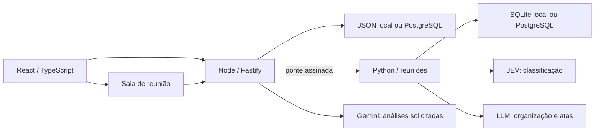

# Norte

O Norte organiza requisitos, verificações, cronogramas, documentos e reuniões de engenharia. A equipe acompanha a origem de cada requisito, suas versões, a revisão humana e as evidências de verificação.

A aplicação começa vazia. Contas, equipes, projetos e participantes só aparecem quando existem no armazenamento. Análises de requisitos, pesquisa de referências e sugestões de verificação são executadas por solicitação explícita.

## Executar com Docker

```bash
docker compose up --build -d
```

Abra `http://localhost:8000`. A imagem inclui Node, Python, dependências e Poppler; o volume `norte-data` conserva os dados. As chaves opcionais são lidas do `.env`, nunca copiadas para a imagem.

O editor Overleaf Community Edition pode rodar localmente:

```bash
python3 scripts/prepare_overleaf.py
docker compose --profile overleaf up --build -d overleaf
```

Abra `http://localhost:8081/launchpad` para criar a conta local. Baixe o ZIP LaTeX de um documento do Norte e importe-o como projeto. O perfil inclui MongoDB, Redis e TeX da imagem oficial, sem montar o socket Docker. Ele fica restrito ao computador local; CE pressupõe usuários confiáveis. A preparação conserva o segredo de convites em arquivo privado. Veja [instalação, exportação e validação local](docs/overleaf.md) e a [documentação oficial](https://github.com/overleaf/toolkit/blob/master/doc/quick-start-guide.md).

O botão **Enviar cópia ao Overleaf** usa a [API oficial](https://www.overleaf.com/devs) para abrir uma cópia em overleaf.com, somente por solicitação. Essa cópia não sincroniza automaticamente; revisão e aprovação vigentes continuam no Norte.

## Executar sem Docker

Requisitos: Linux, Python 3, Node.js 24.20+ e Poppler (`poppler-utils`).

```bash
./setup
./start --no-browser
./stop
```

`./setup` instala as dependências e compila a interface. `./start` abre o navegador; `--no-browser` mantém apenas os serviços. O endereço padrão é `http://127.0.0.1:8000`; `PORT` no `.env` altera a porta. `./prepare-local` prepara as ferramentas necessárias quando o Node do sistema é antigo. Dados e logs locais ficam em `.runtime/`, fora do Git.

Crie uma conta com nome, login e senha. O e-mail é opcional. Convites por nickname funcionam sem SMTP. Em produção, a primeira administração exige o código privado `NORTE_BOOTSTRAP_TOKEN`; o cadastro público não concede esse privilégio. As estatísticas globais exigem autenticação adicional por TOTP.

## Arquitetura



O Node é a autoridade de contas, permissões, projetos, documentos e revisões. O Python recebe operações de reunião pela ponte privada em loopback; sua chave nunca chega ao navegador. Ambos são supervisionados por `scripts/service.py`, com uma única porta pública.

| Diretório | Responsabilidade |
| --- | --- |
| `norte/src/pages` | Páginas carregadas sob demanda |
| `norte/src/components` | Componentes de equipes, chat e entregas |
| `norte/src/lib` | Sessão, navegação, estado remoto e contratos de interface |
| `norte/src/styles` | Tokens, base, layout e estilos por funcionalidade |
| `norte/server` | API, autorização, persistência, documentos e análises |
| `norte/shared` | Regras e referências compartilhadas |
| `meetings/web` | Captura, transcrição, blocos, revisão e atas |
| `meetings/engine` | JEV, assistência editorial e correções por reunião |
| `scripts` | Instalação, supervisão e diagnóstico |
| `tests`, `norte/tests`, `norte/server/*.test.mjs` | Testes isolados e contratos |
| `novo_teste` | Originais LYLE, cenário extraído e resultados em subpastas |

Veja [arquitetura e dados](docs/architecture.md), [reuniões e memórias](docs/meeting-memory.md), [estilos](norte/src/styles/README.md), [implantação](DEPLOY.md) e [instruções para manutenção](AGENTS.md).

## Fluxos principais

- **Requisitos:** árvore por subsistema ou tabela; busca, filtros, colunas configuráveis e abertura pela linha em painel lateral, sem cobrir a tabela. A hierarquia pode ser recolhida. Apontamentos destacam o trecho literal e apontam à referência oficial. A IA sugere; uma pessoa revisa.
- **Verificação:** começa vazia. Sugestões são revisadas antes de virarem planos. Uma execução exige resultado e evidência; alterações relevantes invalidam aprovações anteriores.
- **Cronograma:** começa vazio. A equipe escolhe um modelo de referência e entra em edição. Há hierarquia, dependências, deslocamento encadeado, desfazer e aprovação independente.
- **Documentos:** biblioteca por categoria, pacotes por revisão e área de edição/prévia em página inteira. Abas recentes permitem retornar a documentos, requisitos e atas; rascunhos locais são separados por conta e versão. PDF e ZIP LaTeX usam a versão salva.
- **Mensagens:** texto e imagens na ordem de composição, colagem e anotações. Ajuda e feedback abrem a Administração.
- **Reuniões:** falas em trechos; JEV classifica e o modelo editorial organiza tópicos concisos. A transcrição original permanece disponível. Correções são versionadas e restritas à reunião.
- **Administração:** contas, métricas opcionais e diagnóstico das reuniões às quais a administradora tem acesso. O diagnóstico mostra entradas, perguntas, classificações e memórias efetivamente registradas.

Planos comerciais, comunidade, memória de projeto, concepção, laboratório de ideias e painéis de atividade de equipe foram retirados. A limpeza explícita do ambiente de teste remove os projetos Quetzal e exemplos antigos; uma instalação nova não cria nenhum projeto.

Para instalações PostgreSQL, `node norte/scripts/retire-workspace.mjs --help` descreve a manutenção por plano e fingerprint, com backup transacional privado. O procedimento está em [arquitetura e dados](docs/architecture.md).

## IA e privacidade

Preencha `TYPESAFE_API_KEY` para classificação JEV e `GOOGLE_API_KEY` para Gemini. A configuração detalhada está em `.env.example`. Chaves ausentes não geram resultados fictícios. Os testes padrão usam provedores simulados, sem cobranças.

`#/privacy` e `#/terms` ficam disponíveis antes do cadastro. A política explica armazenamento, áudio do navegador, provedores externos e métricas opcionais. O contato público inicial é `emillyraianerodrigues@gmail.com`; `NORTE_PRIVACY_CONTROLLER`, `NORTE_PRIVACY_EMAIL` e `NORTE_HOSTING_DESCRIPTION` permitem configurar a instalação.

Métricas começam desativadas. Quando autorizadas, registram páginas, tempo ativo e funções predefinidas; não incluem textos, mensagens ou documentos. A administração vê país/região somente quando há proxy confiável configurado. Desativar solicita a exclusão dessas métricas.

## Projeto de revisão LYLE

O comando abaixo prepara uma conta comum, uma equipe e o projeto do documento fornecido, sem pessoas fictícias nem verificações preenchidas. O cronograma provisório usa uma referência ECSS com datas de exemplo que exigem revisão:

```bash
node norte/scripts/seed-workspace-review.mjs --help
```

O procedimento é explícito e repetível; não roda ao iniciar o servidor. Os oito requisitos preservam enunciados, localização e comentários do documento. Referências oficiais e apontamentos não equivalem à determinação de aplicabilidade ou conformidade. As credenciais criadas nesta instalação ficam em `.runtime/workspace-review-credentials.json`, com acesso privado.

## Verificar alterações

```bash
npm --prefix norte run typecheck
npm --prefix norte run lint
npm --prefix norte test
python3 -m unittest discover -s tests -p 'test_*.py'
node --test tests/*.test.cjs
npm --prefix norte run test:visual
VITE_BASE_PATH=/ npm --prefix norte run build
```

Os testes visuais usam Chrome e armazenamento temporário. A documentação de [qualidade](docs/testing.md) distingue testes determinísticos, integração e avaliação de modelos. Um teste com provedor simulado não mede precisão do modelo real.
